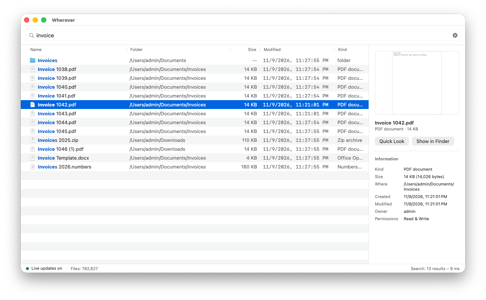
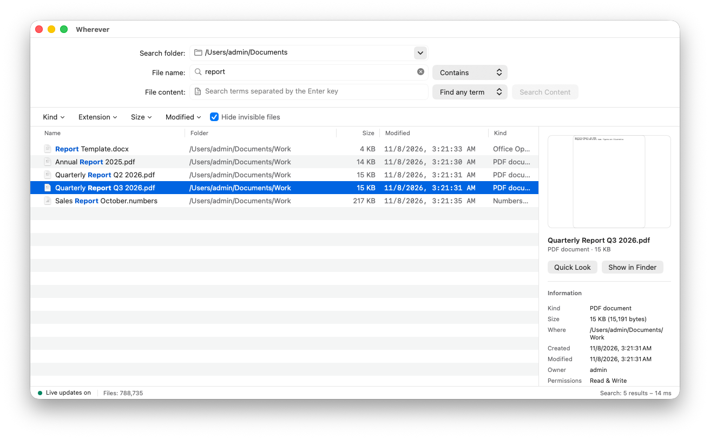
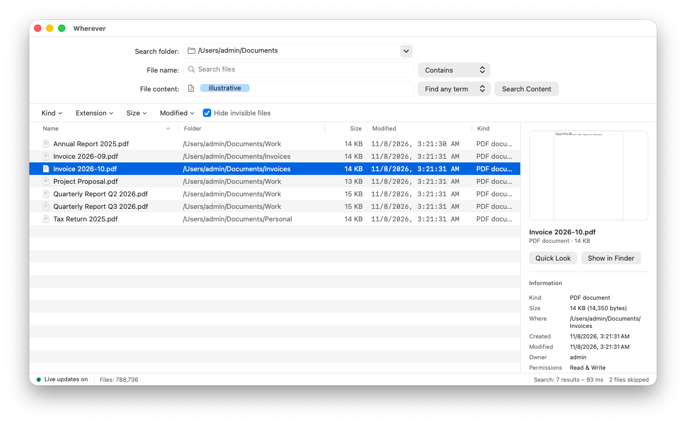
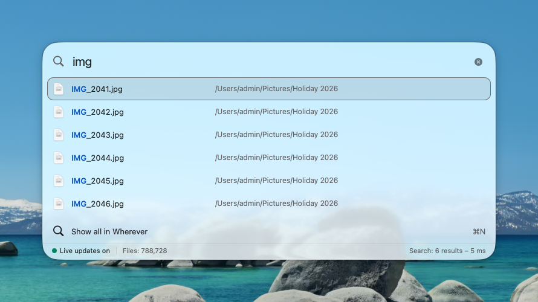
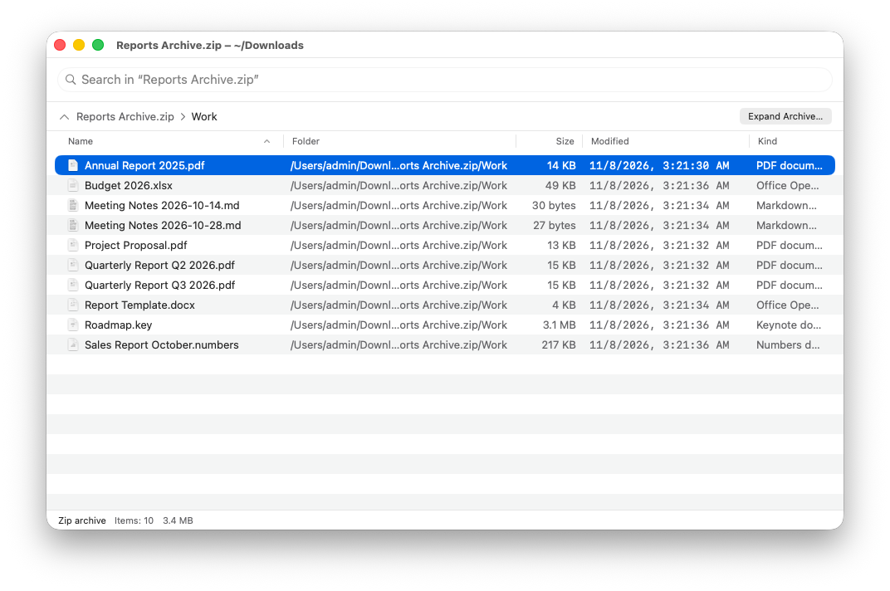
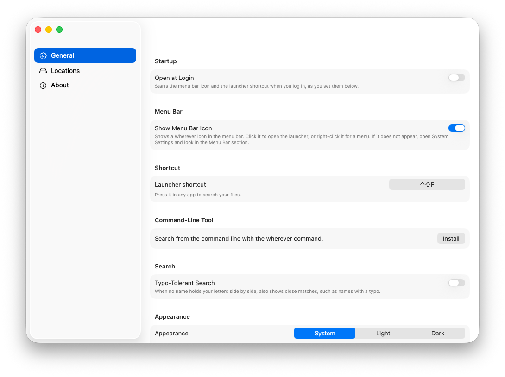
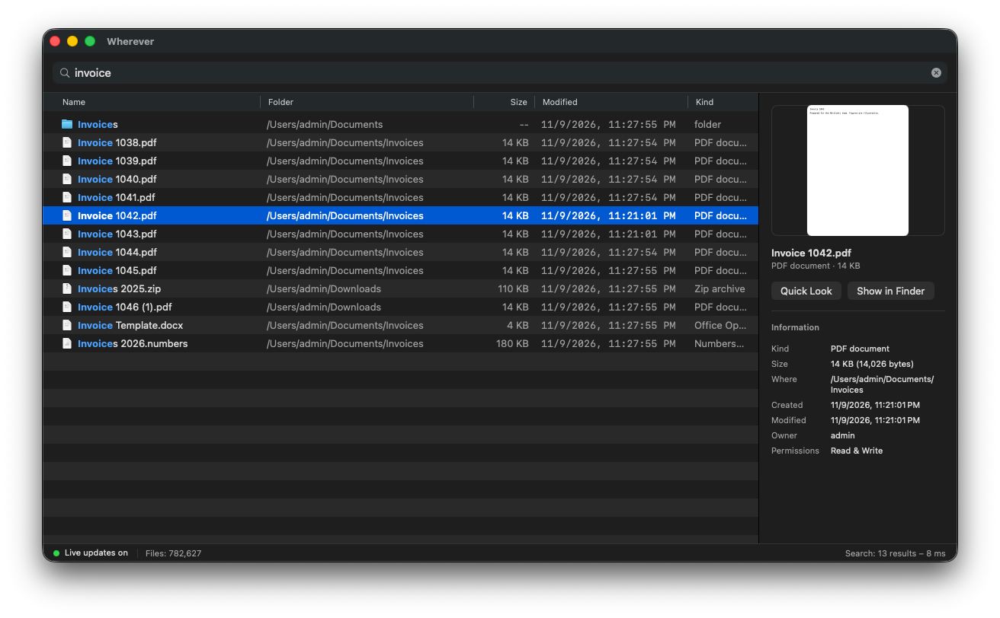

<div align="center">


# Wherever

**Find any file on your Mac, instantly.**

[](https://github.com/writronic/Wherever/releases/latest)


[](LICENSE)
[](https://github.com/sponsors/writronic)

</div>

---

Wherever brings every file name on your disk into one live search. You can find a file by typing part of its name, narrow the results with filters, search the words inside your documents, and open a search panel from any app with one shortcut.

Requires **macOS 13 Ventura** or later.

<picture>
  <source media="(prefers-color-scheme: dark)" srcset="docs/images/simple-mode-dark.png">
  
</picture>

## Features

- **Launcher**: A small panel opens over any app with a global shortcut and searches file names.
- **Menu Bar App**: Click the menu bar icon to open the launcher, or right-click it to open the app.
- **Search as You Type**: Search every file name on your disk and update the results as you type.
- **Typo-Tolerant Search**: An optional setting that finds `explorer.txt` when you type `epxlorer`. Accents work both ways without it.
- **Best Match First**: Names that equal your word or start with it come first, and files you open often move up. That history stays on your Mac.
- **Search Operators**: Narrow results with `ext:pdf`, `size:>10mb`, `modified:<7d` or `in:~/Documents`.
- **Two Modes**: Simple and Normal. Simple searches file names from one field, Normal adds a folder, name matching, filters and Search Content.
- **Command-Line Tool**: Search from Terminal with the `wherever` command.
- **Search Content**: Find the words inside your documents (`.pdf`, `.docx`, etc.).
- **Live Updates**: Results stay current as files change, with no rescan.
- **Archive Windows**: Look inside zip, tarball, RAR, pkg and dmg files in a window inside Wherever, and edit zips and tarballs.
- **Other Disks**: Add a USB or Thunderbolt drive to the index when you choose to.
- **Color Themes**: System Native, Ink and Glass, Warm Paper and Midnight Teal.
- **11 Languages**: English, Deutsch, Español, Français, Nederlands, Polski, Русский, Türkçe, 日本語, 简体中文, العربية

<details>
<summary><b>Full feature list</b>: 24 more, including the File Name menu, the inspector, and keyboard control</summary>

### Search

- **Word Matching**: A word matches names that hold its letters side by side, and `!name` leaves out names that hold it.
- **Exact, Start and End**: `'name` matches the exact letters, `^name` the start of a name, and `name$` the end.
- **Patterns**: `re:` takes a regular expression and `glob:` a wildcard pattern.
- **Hide Invisible Files**: Results include hidden files and system folders, with an option to hide them.
- **Empty Search**: With nothing typed, the list shows every indexed file from A to Z.

### Normal Mode

- **Three-Row Form**: The form has **Search folder**, **File name** and **File content** rows.
- **File Name Menu**: Contains, Matches, Begins with, Ends with, Extension, Wildcard and Regex.
- **File Content Menu**: **Find any term** or **Find all terms**.
- **Stop a Read**: **Stop** ends a Search Content read and keeps what it found. Pages, Numbers, Keynote and epub files are skipped, and a scanned PDF has no text to find.
- **Filter Pills**: Kind, Extension, Size and Modified, with a **Hide invisible files** checkbox beside them.

### Results

- **Seven Columns**: Name, Folder, Size, Modified, Created, Opened and Kind. Each column sorts the list, and every column but Name can be hidden.
- **Inspector**: An optional pane with a preview and the details of the selected file.
- **More Than One Window**: Each window has its own search.
- **Keyboard Control**: Keys open a result, show it in Finder, preview it with Quick Look and copy its path. You can also drag a row into another app.

### Launcher

- **Preview in the Panel**: A Quick Look view opens inside the panel and follows the selection.
- **Show all in Wherever**: The last row opens the main window with the same text.
- **Your Own Shortcut**: You can change the key that opens the launcher.

### Disks and the Menu Bar

- **Excluded Paths**: Wherever indexes the startup disk. Other local disks start in the **Excluded Paths** list and stay out of the results until you index them. Network drives are not indexed or listed.
- **Menu Bar Icon**: The icon opens the launcher, and its menu holds Live Updates, Open Wherever, Settings…, Keyboard Shortcuts and Quit Wherever.
- **Wherever Helper**: Closing the last window quits Wherever, and this small helper keeps the menu bar icon and the launcher shortcut running.
- **Open at Login**: The menu bar icon and the launcher shortcut can start when you log in.

### Updates and Settings

- **Light / Dark / System Appearance**: **System** follows macOS, and every window changes at once.
- **Automatic Update Check**: Wherever can check about once a day, and it asks before it installs anything.
- **Import and Export Settings**: **Export…** saves your settings as a JSON file, and **Import…** reads that file back.

</details>

## Screenshots

<table>
  <tr>
    <td width="50%"></td>
    <td width="50%"></td>
  </tr>
  <tr>
    <td align="center">Normal mode: a folder, a name and filters</td>
    <td align="center">Search Content finds the words inside files</td>
  </tr>
  <tr>
    <td width="50%"></td>
    <td width="50%"></td>
  </tr>
  <tr>
    <td align="center">The launcher opens with ⌃⇧F in any app</td>
    <td align="center">Look inside an archive without unpacking it</td>
  </tr>
  <tr>
    <td width="50%"></td>
    <td width="50%"></td>
  </tr>
  <tr>
    <td align="center">Settings</td>
    <td align="center">Dark appearance</td>
  </tr>
</table>

## Quick Start

### 1. Install Wherever

Download the latest `.dmg` from the [Releases page](https://github.com/writronic/Wherever/releases/latest), open it, and drag Wherever to your Applications folder. The app ships as a **universal binary** (Apple Silicon + Intel). Every release is **code-signed, notarized, and stapled** by Apple.

Or install it with [Homebrew](https://brew.sh):

```sh
brew install --cask writronic/tap/wherever
```

### 2. Turn On Full Disk Access

The first time you open Wherever, the welcome window walks you through the setup. Click **Open System Settings** and turn on Wherever under Privacy & Security, Full Disk Access. Then click **Next** through the pages and **Let's Go!** on the last one.

> [!IMPORTANT]
> Wherever needs Full Disk Access to see every folder. Until you grant it, only the welcome window opens.

### 3. Search

Type in the search field. The arrow keys move through the results, Return opens a file and ⌘Return shows it in Finder.

### 4. Switch Modes

Choose **View** > **Normal** for the form and filters. **View** > **Simple** takes you back.

## Documentation

Read the [documentation](docs/README.md) for a page on each feature, the settings, the keyboard shortcuts and troubleshooting.

## Privacy

Everything stays on your Mac, and Wherever has no telemetry. It connects to the web only for updates: a check when you choose **Check for Updates…**, or about once a day with **Automatically check for updates** on, and the download when you install an update. [PRIVACY.md](PRIVACY.md) lists what Wherever stores and what a check sends.

## Development

### Build from Source

1. Install Xcode 27 and the two Rust targets with [rustup](https://rustup.rs):

   ```sh
   rustup target add aarch64-apple-darwin x86_64-apple-darwin
   ```

2. Clone the repository:

   ```sh
   git clone https://github.com/writronic/Wherever.git
   cd Wherever
   ```

3. Build the engine, with the Cargo output outside the source tree:

   ```sh
   CARGO_TARGET_DIR="$HOME/.cache/wherever-cargo" /bin/sh scripts/build-engine.sh
   ```

4. Open `Wherever.xcodeproj` and run the **Wherever** scheme. Xcode fetches [Sparkle](https://sparkle-project.org) through Swift Package Manager on first open.

> [!NOTE]
> Debug builds sign with Writronic's team. Set your own team under Signing & Capabilities. Each signing identity needs its own Full Disk Access switch.

## Contributing

Read the [contributing guide](.github/CONTRIBUTING.md) before you start. It covers the build, the tests and how to send a change.

### Bug Reports & Feature Requests

Search the [existing issues](https://github.com/writronic/Wherever/issues) first. Then open a new one with the Bug Report or Feature Request template.

### Localization

Wherever supports 11 languages. Its translation files are in `Wherever/Resources/l10n/`, one `.lproj` folder each. A new interface string goes into all 11.

### Code

Fork the repository and branch from `main`. Keep one change in each pull request, open it against `main`, and rebase when `main` moves. Please follow the [pull request template](.github/PULL_REQUEST_TEMPLATE.md) and keep changes focused.

## License

Wherever is available under the [GPL v3.0 or later](LICENSE).

---

<div align="center">

**Made with ❤️ by Writronic**

</div>
